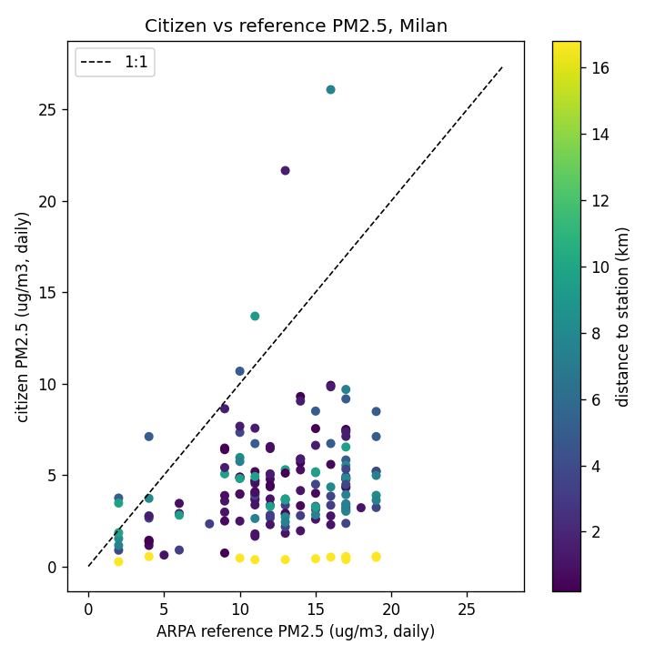

# Citizen Air-Quality Sensor Reliability 📊

[](https://www.python.org/)
[](https://spark.apache.org/)
[](https://kafka.apache.org/)
[](https://www.docker.com/)
[](https://opensource.org/licenses/MIT)

> An end-to-end data pipeline evaluating the reliability and humidity bias of low-cost citizen air-quality sensors in Milan against reference-grade stations.

## 📖 Overview
How reliable are low-cost citizen air-quality sensors? This project ingests data from [Sensor.Community](https://sensor.community) (a global network of DIY sensors) to answer two concrete questions with statistical rigor and proper data-quality accounting:

1. **Humidity Bias:** How large is the over-reading effect at high relative humidity, and does a simple correction actually help?
2. **Reference Agreement:** How do citizen sensors compare against nearby reference-grade stations (evaluating bias and error distributions, not just a single R²)?

*Note: This is deliberately not a live air-quality map. The core contribution is the robust data pipeline, the reliability analysis, and the honest data-quality accounting.*

## Tech Stack
* **Data Ingestion & Streaming:** MQTT, Mosquitto, Apache Kafka
* **Data Processing:** Apache Spark (Structured Streaming), Pandas, Parquet
* **Infrastructure & CI:** Docker, Docker Compose, GitHub Actions, Makefile
* **Languages:** Python (3.11/3.12)
* **Semantic Web (Optional):** SAREF/RDF, SPARQL

## 🏗️ Architecture
The data source is an HTTP JSON API that publishes per-sensor averages roughly every 5 minutes. We manufacture a stream via a poller to ensure correct event-time processing and reprocessing.

```text
live:     poller --MQTT--> Mosquitto --> bridge --\
                                                    +--> Kafka --> Spark Structured Streaming
backfill: archive replay ---------------------------/            (event-time, dedup, joins)
                                                                          |
                                                                          v
                                                          partitioned Parquet --> pandas analysis
```
*Detailed design decisions (e.g., why MQTT + Kafka) are documented in [DESIGN.md](DESIGN.md).*

## Key Findings (Milan, Sept 2026)
*(Full analysis available in [ANALYSIS.md](ANALYSIS.md))*

<p align="center">
  
</p>

* **Severe Under-reading:** Citizen sensors substantially under-read compared to reference stations (mean 4.4 vs 12.5 µg/m³). The median bias is -8.3 µg/m³, which holds true even for sensors within a 5 km radius.
* **Humidity vs PM:** The marginal PM2.5-vs-RH association is weakly negative, dominated by diurnal confounding (RH peaks overnight, PM peaks at rush hour). Even at >= 99% RH, PM2.5 is not cleanly elevated.
* **Correction is Harmful:** Because the sensors significantly under-read, applying the standard kappa-Koehler humidity correction actually *increases* the error. A per-sensor scale calibration is needed, not a blanket humidity fix.

## 💻 Getting Started

**Prerequisites:** Docker, Docker Compose, Python 3.11+.

### 1. Setup
```bash
git clone [https://github.com/micelimatteo/milan_sensors.git](https://github.com/micelimatteo/milan_sensors.git)
cd milan_sensors
cp .env.example .env  # Remember to set a valid User-Agent contact address
make install          # Install host packages and dev dependencies
```

### 2. Reproduce the Analysis (Offline)
No live services are required. This process curates the archive into Parquet files inside a pinned Spark container and runs the analysis on the host.
```bash
make curate START=2026-09-01 END=2026-09-13   # Archive -> data/curated
make analyze                                  # Humidity vs PM -> artifacts/
make reference                                # Citizen vs ARPA ref -> artifacts/
```

### 3. Run the Live Streaming Pipeline
```bash
# Terminal 1: Start infra + poller -> MQTT -> bridge -> Kafka
docker compose --profile live up --build   

# Terminal 2: Run Spark to drain Kafka -> data/curated
make stream                                
```
*(To backfill through Kafka instead of the live poller: `make replay START=... END=...`)*

## Testing & CI
```bash
make test         # Run host tests
make test-spark   # Run Spark transform tests in the pinned container
```
Continuous Integration (GitHub Actions) automatically runs linting (`ruff`) and the full test suite (with JDK) on every push.

## Optional: Semantic Layer (SAREF/RDF)
An optional, self-contained phase models the data using the SAREF ontology and answers reliability questions via SPARQL.
```bash
pip install -e ".[rdf]"
make graph        # Builds artifacts/graph.ttl and executes SPARQL queries
```

## Data Sources & License
* **Code:** [MIT License](LICENSE)
* **Measurements:** [Sensor.Community](https://sensor.community) (ODbL 1.0 / DbCL 1.0)
* **Reference Data:** ARPA Lombardia open data (dati.lombardia.it)
